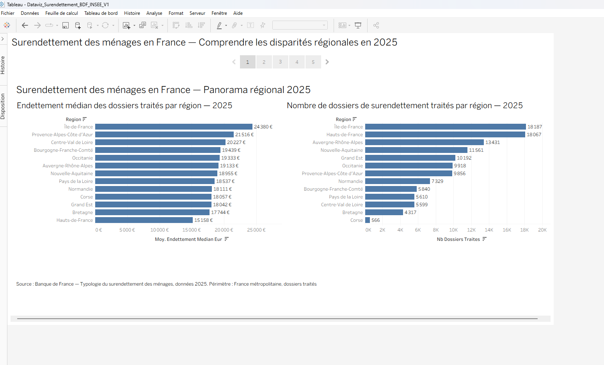
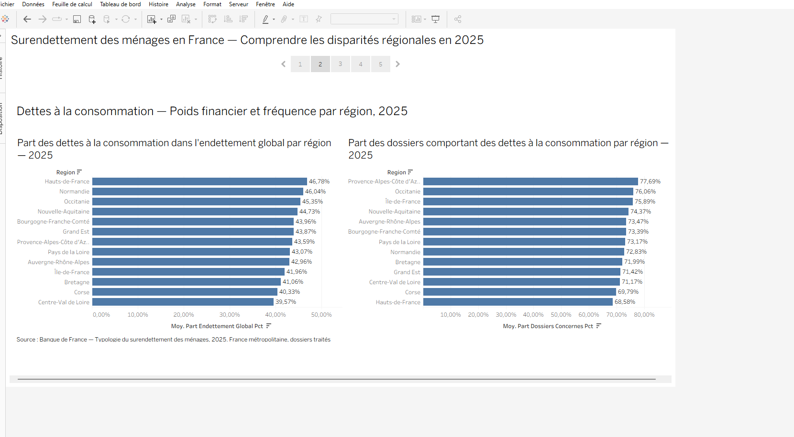
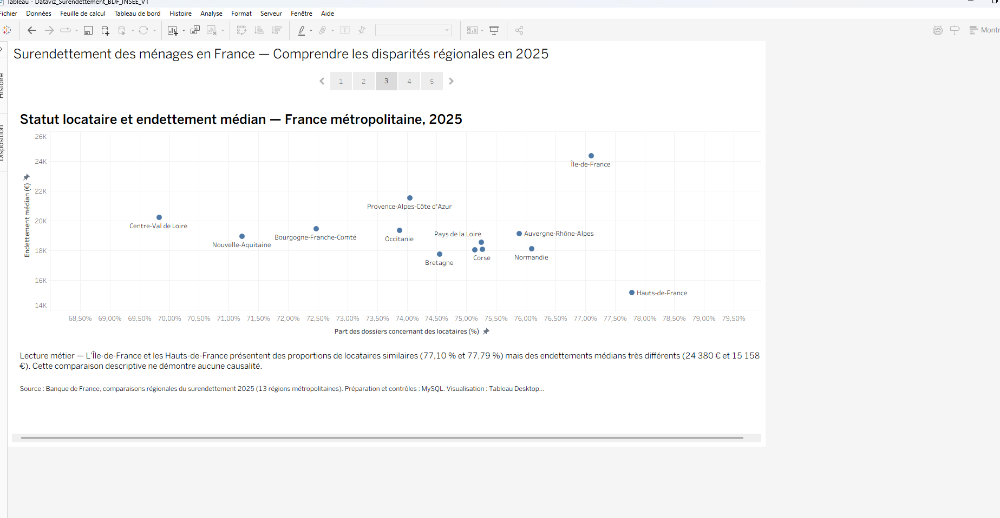
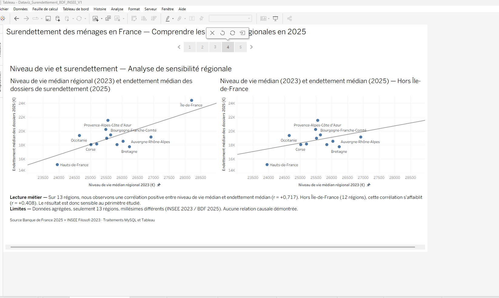
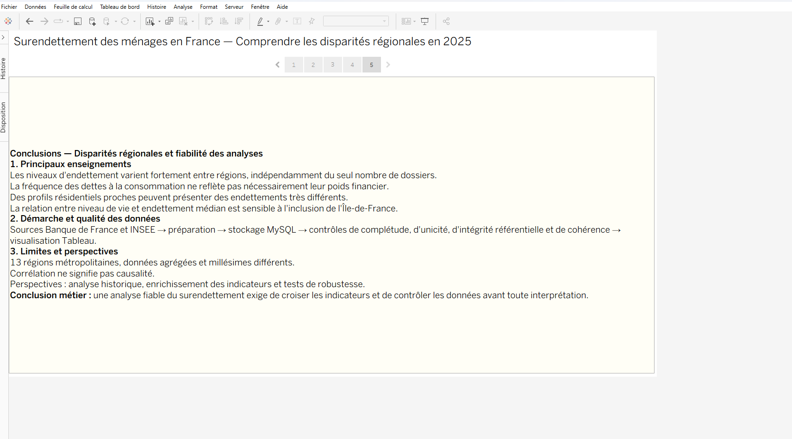

# Présentation du projet BDF × INSEE — 17 novembre 2026

Ce dossier contient **cinq captures d'écran authentiques** de l'histoire Tableau présentée le 17 novembre 2026. Ce sont des captures de l'interface de Tableau Desktop, et non des exports graphiques autonomes. Elles sont conservées ici comme illustrations du livrable ; le classeur source est dans `../04_Tableau/`.

## Parcours des cinq plans

### 1. Panorama régional

- Comparaison de l'endettement médian par dossier traité et du nombre de dossiers régionaux (BDF 2025).
- Exemple : Île-de-France — **18 187 dossiers**, **24 380 €** d'endettement médian ; Hauts-de-France — **18 067 dossiers**, **15 158 €**.
- Message : des volumes proches ne signifient pas des montants médians comparables.

### 2. Dettes à la consommation

- Deux dénominateurs distincts : **part des dossiers concernés** et **part des dettes à la consommation dans l'endettement global**.
- Exemple Provence-Alpes-Côte d'Azur : **77,69 %** de dossiers concernés pour **43,59 %** de l'encours total.
- Attention : présence d'une dette et poids financier de cette dette ne sont pas équivalents.

### 3. Statut résidentiel et endettement médian

- Nuage de points : proportion de dossiers concernant des locataires versus endettement médian.
- Île-de-France : **77,10 %** ; Hauts-de-France : **77,79 %** ; les niveaux d'endettement médians restent éloignés.
- Message : la comparaison est **descriptive** ; elle n'établit aucune causalité.

### 4. Niveau de vie et analyse de sensibilité

- Comparaison du niveau de vie médian **INSEE Filosofi 2023** avec l'endettement médian **BDF 2025**.
- Corrélation de Pearson : **r = +0,717** avec l'Île-de-France (13 régions) ; **r = +0,408** sans l'Île-de-France (12 régions).
- La relation reste positive mais plus faible ; ne pas en déduire une absence de relation ni une causalité.
- Les deux jeux de données portent sur des **millésimes différents** et des **indicateurs régionaux agrégés**.

### 5. Conclusion et limites

- Croiser plusieurs dimensions (volume, montant, type de dette, profil, contexte économique).
- Traçabilité des sources, préparation, modèle MySQL, contrôles SQL puis Tableau.
- Limites : 13 régions, données agrégées, millésimes distincts ; prolongements historiques possibles.

## Provenance et réutilisation

- Sources : statistiques de la Banque de France sur le surendettement 2025 ; INSEE (niveau de vie et pauvreté 2023 ; chômage 2025 pour le contexte).
- Les données traitées et la documentation SQL sont situées dans `../02_Preparation/` et `../03_SQL/`.
- Les contrôles de fidélité sont documentés dans `../06_Controles_DQ/`.
- Ces captures sont des **preuves visuelles du rendu Tableau**. Pour en produire une version plus homogène, utiliser ultérieurement l'export Tableau, sans masquer les limites statistiques.
